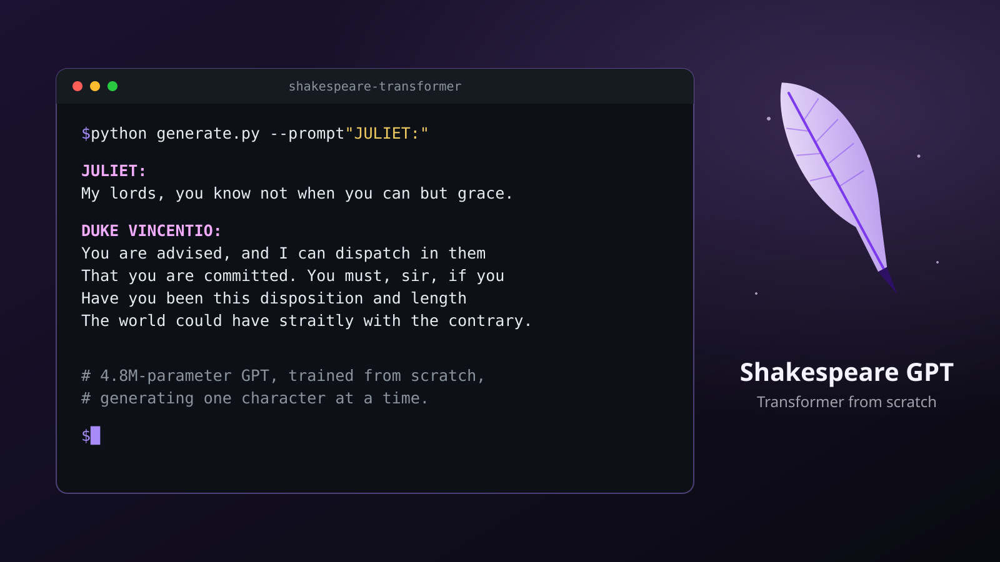
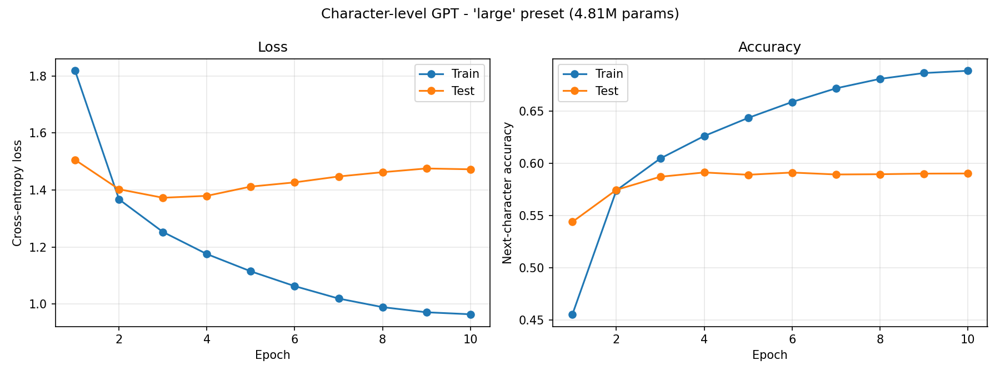

# Shakespeare GPT — a Transformer written from scratch

A character-level, decoder-only Transformer (GPT-style) implemented in plain PyTorch and trained on the complete works of Shakespeare (~1.1M characters). Given a prompt, it writes new "Shakespeare" one character at a time.

<p align="center">
  
</p>

## What's inside

- **Multi-head causal self-attention**: a single linear layer produces Q, K and V for every head; scaled dot-product attention uses an additive `-inf` mask above the diagonal so that no token can see the future.
- **Pre-norm Transformer blocks**: `LayerNorm → attention → residual`, then `LayerNorm → MLP (4×, GELU) → residual`.
- **Learned token and position embeddings**, a final LayerNorm and a linear language-model head.
- **Sampling** with temperature and top-k filtering.
- **Training**: AdamW, cosine learning-rate schedule, gradient clipping, and evaluation on a held-out test text.

## Results

Two configurations were trained on an RTX 4060 laptop GPU:

| Preset | Params | Context | Layers × heads × dim | Training time | Test loss | Next-char accuracy |
|---|---|---|---|---|---|---|
| `course` (original assignment) | 0.09 M | 10 chars | 3 × 3 × 48 | 5 min | 1.89 | 44 % |
| `large` | 4.8 M | 128 chars | 6 × 8 × 256 | 37 min | **1.37** (best, epoch 3) | **59 %** |

<p align="center">
  
</p>

The larger model reaches its best test loss after 3 epochs and then starts to overfit: the training loss keeps falling while the test loss rises slowly. More dropout or early stopping would be the next step.

### Samples

**`course` preset** — with only 10 characters of context, it learns the shape of words and the play format, but not real sentences:

```
JULIET:
I thinks, whilly the me their done, the he still on to leasted servery lord words of then bond and find my brother, this thyself.
```

**`large` preset** — with 128 characters of context, it produces real words, punctuation, line breaks and speaker turns:

```
JULIET:
My lords, you know not when you can but grace.

DUKE VINCENTIO:
You are advised, and I can dispatch in them
That you are committed. You must, sir, if you
Have you been this disposition and length
The world could have straitly with the contrary.
```

## Getting started

```bash
pip install -r requirements.txt
python train.py --preset large          # or --preset course (about 5 min on GPU)
python generate.py --preset large --prompt "ROMEO:\n" --length 500
```

Training saves the checkpoint and metrics in `results/<preset>/`, and its learning curves in `assets/`.

## Project structure

```
model.py       GPT, Block, CausalSelfAttention, GELU
data.py        character tokenizer and sliding-window dataset
train.py       training loop, evaluation, per-epoch samples, plots
generate.py    text generation from a checkpoint
data/          Shakespeare train / test text
```

## Context

Built by **Samuel Hayat** for the *Introduction to Machine Learning* course at the Hebrew University of Jerusalem. The overall structure follows Andrej Karpathy's [minGPT](https://github.com/karpathy/minGPT). The attention, the training loop and the sampling were implemented as part of the course. For this repository, the code was reorganized and a larger `large` configuration was added.
